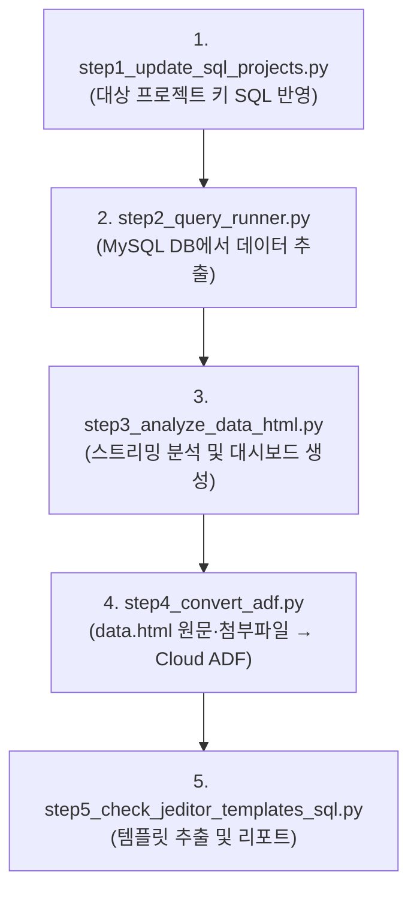

# JEditor Migration & Analysis Toolkit

Jira Data Center의 JEditor 추출·분석 도구와, **data.html의 HTML/Jira wiki/Markdown·첨부파일을 Cloud ADF로 이전하는 도구**를 제공합니다.

---

## 📌 주요 실행 순서 (Standard Workflow)

DC 추출·분석은 1~3단계, Cloud ADF 이전은 4단계, 템플릿 현황 추출·리포팅은 5단계입니다.
마이그레이션 당일에는 파일명 앞의 `step1_`부터 `step5_` 순서로 실행합니다. 기존 파일명은 호환용 실행/가져오기 경로로 유지합니다.



---

## 🚀 단건 이슈 통합 테스트 파이프라인 (`pipeline_single_issue.py`)

이슈 번호 1개만 입력하여 **Step 1부터 Step 4까지 전 과정을 스크립트 한 개로 자동 검증**할 수 있는 원클릭 테스트 파이프라인입니다.


```bash
# 1. 대화형 프롬프트로 실행 (이슈 번호 질의응답 안내)
python3 pipeline_single_issue.py

# 2. 기본 미리보기 실행 (Dry-Run, Cloud 변경 없음)
python3 pipeline_single_issue.py AAOSFRWDEV-543

# 3. Cloud 테스트 이슈(예: Sandbox CFMT-3)로 대상 변경하여 실제 반영 (Real-Run)
python3 pipeline_single_issue.py AAOSFRWDEV-543 --target-issue CFMT-3 --real-run

# 4. 특정 Step만 선별 실행 (예: Step 3, 4만 실행)
python3 pipeline_single_issue.py AAOSFRWDEV-543 --steps 3,4 --input data.html
```

- **주요 특징**:
  - **초고속 단건 DB 추출**: SQL의 `target_projects` CTE와 `i.issuenum = {num}` 인덱스 조건을 자동 주입하여 수 분 걸리던 전체 조회를 수 밀리초(~5ms) 내로 완료
  - **다중 ADF 대상 컬럼 누락 방지**: 본문에만 JEditor 이미지가 있고 커스텀 필드에는 텍스트/공지/표만 있을 때 커스텀 필드가 누락되던 문제를 해결. 단건 파이프라인에서는 `textvalue` 및 `stringvalue`에 값이 존재하는 모든 커스텀 필드(예: `First vehicle by platform Notice`, `ESTRACK Notice` 등 각종 Notice/공지/비고 필드 포함)를 100% 완전 추출 (필요 시 `--strict-jeditor` 옵션으로 엄격 필터링 가능)
  - **대규모/전체 마이그레이션 쿼리(`jeditor_mysql_queries.sql`) 안전 확장**: 전체 프로젝트 대상 조회 시 DB 부하(Full Table Scan)를 유발하지 않도록 인덱스 친화적 조건(`textvalue IS NOT NULL`, `customfieldtypekey` 기반 JEditor/TextArea 탐색, `Notice`/`공지`/`비고` 및 마크업 탐지)으로 설계되어 다양한 커스텀 필드를 광범위하고 안전하게 검출
  - **오프라인/Fallback 모드**: DB가 연결되지 않은 로컬 환경에서도 기존 `data.html` 또는 `examples/data_sample.html`에서 해당 이슈를 고속 탐색하여 끊김 없이 테스트 가능
  - **완전한 결과물 격리**: 모든 산출물을 `single_issue_reports/{ISSUE_KEY}/` 디렉터리에 독립적으로 생성 (`step1_query_*.sql`, `step2_data_*.html`, `step3_data_dashboard.html`, `step4_adf_report/`)
  - **안전한 모드 전환**: 기본값은 `--dry-run`(미리보기)이며, `--real-run` 지정 시에만 Cloud API를 호출하여 안전성 보장


---

### Step 1. 대상 프로젝트 SQL 반영 (`step1_update_sql_projects.py`)
상위 디렉터리의 `../projects.txt`에 정의된 대상 프로젝트 키 목록을 읽어 SQL 쿼리 파일(`jeditor_mysql_queries.sql`, `jeditor_template_queries.sql`)의 CTE(`WITH target_projects`) 구문을 자동으로 업데이트합니다.

```bash
# 기본 실행 (../projects.txt -> 기본 SQL 파일들 갱신)
python3 step1_update_sql_projects.py

# 특정 파일 경로 지정 시
python3 step1_update_sql_projects.py --projects ../projects.txt --sql jeditor_mysql_queries.sql
```
- **입력**: `../projects.txt` (한 줄에 프로젝트 키 1개씩 작성, `#` 주석 및 공백 무시)
- **대상 파일**: `jeditor_mysql_queries.sql`, `jeditor_template_queries.sql`

---

### Step 2. Jira DB에서 JEditor 데이터 추출 (`step2_query_runner.py`)
Jira Data Center MySQL 데이터베이스에 접속하여 JEditor 본문(Description, Environment), 댓글(Comment), 커스텀 필드 데이터를 조회한 후 HTML 파일(`data.html`)로 스트리밍 추출합니다.

```bash
# 기본 실행 (대화형 마법사 메뉴 실행 -> 단계별 선택 후 data.html 생성)
python3 step2_query_runner.py

# DB 부하 최소화 초저부하 모드 (프로젝트 1개씩 + 배치 간 2초 쿨다운 대기)
python3 step2_query_runner.py --no-prompt --project-batch-size 1 --cooldown-seconds 2

# 배치/CI 등 자동화 환경용 (대화형 메뉴 건너뛰기)
python3 step2_query_runner.py --no-prompt --filter-projects AA,BDD,CFMT --project-batch-size 10
```
- **주요 특징**:
  - **초저부하 DB 보호 기능**:
    - **배치 간 쿨다운 대기 (`--cooldown-seconds`, `-c`)**: 각 배치 완료 후 지정한 초 동안 대기하여 MySQL CPU 100% 지속을 방지하고 일반 사용자 쿼리에 리소스 양보
    - **초저부하 단일 프로젝트 배치 (`--project-batch-size 1`)**: 프로젝트를 1개씩 순차 조회하여 InnoDB 버퍼 풀 및 I/O 부하 극소화
    - **자동 세션 최적화**: 연결 시 `SET SESSION TRANSACTION READ ONLY`, `READ COMMITTED`, `net_timeout` 자동 적용으로 언두 로그 및 락 오버헤드 원천 차단
    - **터미널 경고(Warning) 완전 억제**: PyMySQL, MySQL Server Warning(1292, 1366, 3170 등), 미완료 버퍼 경고 등을 깔끔하게 필터링하여 클린 콘솔 출력 유지
  - **대화형 메뉴 마법사(Interactive Wizard)**: 파라미터를 외울 필요 없이 SQL 파일, 대상 프로젝트, 배치 크기, 저장 방식을 번호로 간편하게 선택
  - **프로젝트별 분할 저장(`data_projects/{PKEY}.html`) 지원**: 용량 폭증 및 브라우저 다운을 방지하기 위해 프로젝트 단위로 각각 별도 HTML 파일로 분할 저장
  - **마스터 인덱스 대시보드(`data_projects/index.html`) 자동 생성**: 전체 프로젝트 목록, 건수, 필드 분포를 한눈에 검색 및 클릭하여 개별 열람할 수 있는 반응형 대시보드 제공
  - `SSDictCursor` 서버 사이드 커서를 사용하여 대용량 데이터 조회 시 메모리 부하 방지
  - 대상 프로젝트를 안전한 크기로 분할 페이지네이션하여 쿼리 타임아웃 및 DB 부하 원천 차단
  - 콘솔에 실시간 배치 진행률(%), 조회 건수, 경과 시간, 잔여 예상 시간(ETA) 및 완료 후 상세 통계 요약 출력
  - `../projects.txt` 자동 감지 및 중단 시 안전한 HTML 태그 닫기(`KeyboardInterrupt` 방어)
- **입력**: `jeditor_mysql_queries.sql` (또는 `jeditor_template_queries.sql`)
- **출력**: `data_projects/{PKEY}.html` 및 `data_projects/index.html` (또는 단일 `data.html`)
- **설정**: `../env` 또는 `./env`의 DB 접속 정보(`JIRA_DB_HOST`, `JIRA_DB_PORT`, `JIRA_DB_USER`, `JIRA_DB_PASSWORD`, `JIRA_DB_NAME`)

---

### Step 3. 추출 데이터 스트리밍 분석 및 대시보드 생성 (`step3_analyze_data_html.py`)
`step2_query_runner.py`로 생성된 대용량 `data.html`을 메모리 효율적인 스트리밍 방식으로 파싱하여 프로젝트별/필드별 JEditor 사용 통계를 집계하고 반응형 HTML 대시보드(`data_dashboard.html`)를 생성합니다.

```bash
# 기본 실행 (data.html 분석 -> 콘솔 출력 및 data_dashboard.html 생성)
python3 step3_analyze_data_html.py

# 텍스트 요약 보고서 저장 및 대시보드 파일명 지정
python3 step3_analyze_data_html.py data.html -o summary_report.txt --html-output data_dashboard.html

# 대시보드 HTML 생성을 비활성화하고 콘솔 통계만 확인할 때
python3 step3_analyze_data_html.py data.html --no-html
```
- **주요 기능**:
  - 1MB 청크 단위 스트리밍 파싱으로 수 GB 이상의 대용량 HTML 파일도 최소 메모리로 고속 처리
  - 필드별(Description, Environment, Comment, Custom Field), 상태별, 이슈 유형별 통계 집계
  - JEditor 감지 유형(`Attachment` vs `Renderer/Text`) 및 첨부/이미지 태그 비율 분석
  - Chart.js 및 실시간 검색 필터링이 포함된 반응형 Executive Dashboard(`data_dashboard.html`) 생성

---

### data.html → Jira Cloud ADF (`step4_convert_adf.py`)

```bash
python3 step4_convert_adf.py
```

이슈 번호만 붙이면 SANDBOX 단건 실제 반영으로 실행합니다.
`data.html`에 해당 이슈가 없으면 Cloud 요청 전에 중단합니다.

```bash
python3 step4_convert_adf.py ESTRACK-14285
python3 step4_convert_adf.py ESTRACK-14285 --dry-run  # 미리보기
```

대화형으로 입력 파일, 대상 Cloud, 원본 이슈/프로젝트/전체, 필드·ID 매핑,
SSL, 원본 첨부파일 Jira 환경·별칭, 재시도·워커·결과 경로와 실행 모드를 선택합니다.
각 content의 export escape/표시용 br을 복원한 뒤 혼합 HTML/Jira wiki/Markdown을
ADF로 변환합니다. 첨부가 Cloud에 없으면 원본에서 내려받아 업로드하고 본문에 연결합니다.

단건은 이전 Success/SKIPPED 기록을 무시하고 일치하는 행만 파싱합니다.
원본 이슈와 다른 대상 테스트 이슈도 선택할 수 있습니다. 전체 사전 행 수 계산은 없습니다.
Custom field metadata는 조회하지 않습니다. 커스텀 필드는 기본적으로 명시적 매핑이 필요하며,
실행 폴더 상위의 `id-mappings-jira-classic-customField.html`을 자동으로 읽습니다.
다른 HTML/JSON은 `--field-map`으로 지정합니다. 동일 ID 사용이 확인된 환경에서만
`--allow-same-field-ids`로 누락 매핑의 원본 ID 사용을 허용합니다.
Description과 Environment는 기본적으로 동일 ID로 처리합니다.

미리보기는 다운로드·업로드·PUT을 하지 않습니다. 실제 반영에서만 첨부파일을 이전하고
필드를 교체합니다. 원문/Cloud 기존 필드/변환 ADF/첨부 결과를 실행별 JSON으로 남깁니다.
원본 data.html은 덮어쓰지 않습니다. 댓글은 대응할 comment ID가 없어 제외 사유를 기록합니다.

배포/인증/한계/테스트 방법: [FILE_MIGRATION.md](FILE_MIGRATION.md).

### Step 5. JEditor 템플릿 추출 및 리포팅 (step5_check_jeditor_templates_sql.py)
Jira DB의 AO_BF4748_PROJECT_TEMPLATE에서 템플릿을 조회해 HTML 리포트를 생성합니다. DB 직접 조회 또는 Step 2에서 만든 SQL 결과 HTML을 입력으로 사용할 수 있습니다.

```bash
# DB 직접 조회 (기본 출력: template_report.html)
python3 step5_check_jeditor_templates_sql.py --env ops

# Step 2에서 생성한 템플릿 SQL HTML을 사용
python3 step5_check_jeditor_templates_sql.py --input templates_output.html --env ops

# 프로젝트 필터와 리포트 경로 지정
python3 step5_check_jeditor_templates_sql.py --project AA,BDD --output template_report.html
```
- **리포트**: 템플릿 상세, 템플릿 수, 템플릿 보유 프로젝트 수, Auto-fill 설정 수를 담은 `template_report.html` 및 Confluence에 바로 붙여넣을 수 있는 `template_report_confluence.html` 자동 생성
- **적용 필드 ID(명칭) 표기**: 커스텀 필드인 경우 `customfield_10010(Release Notes)` 형태로 커스텀 필드 ID 옆에 필드명을 함께 표기합니다. Jira 표준 시스템 필드(`Description`, `Environment`) 및 미지정 필드(`⚠️ 미지정 (필드 없음)`)는 직관적으로 식별됩니다.
  - Jira REST API(`rest/api/2/field`) 또는 DB(`customfield` 테이블) 접속 시 320여 개 커스텀 필드를 자동 동기화 및 캐싱(`jira_custom_fields_cache.json`)
  - 오프라인/파일 모드에서는 `custom_fields.json` 자동 로드 및 CLI 인자(`--custom-fields-map`, `--custom-fields-file`) 지원
- **이슈 유형 숫자(문자) 자동 변환**: JEditor DB에 숫자 ID(`10000, 10001` 등)로 저장된 이슈 유형을 `10000(Epic), 10001(Story)` 형태의 `숫자(문자)` 포맷으로 자동 변환하여 표기합니다.
  - Jira REST API(`rest/api/2/issuetype`) 또는 DB(`issuetype` 테이블) 접속 시 130여 개 이슈 유형을 자동 동기화 및 캐싱(`jira_issue_types_cache.json`)
  - 오프라인/파일 모드에서는 기본 내장 매핑 및 `issue_types.json` 자동 로드, CLI 인자(`--issue-types-map`, `--issue-types-file`)를 통한 커스텀 매핑 지원
- **Confluence 복사**: 브라우저 대시보드에서 `[📋 필터 결과 표 전체 복사 (N건)]` 또는 `[📋 Confluence 표 복사]` 버튼 클릭 시, 검색 및 프로젝트 필터가 적용된 전체 표를 Confluence 편집 화면에 네이티브 표로 즉시 붙여넣기(`Ctrl+V`/`Cmd+V`) 가능한 서식으로 클립보드 복사 지원 (Markdown 전체 복사, Storage Format XML, TSV 및 단일 행/본문 내용 개별 복사 마법사 포함)
- **DB 설정**: ../env 또는 ./env. HTML 덤프 입력 시 DB 접속 불필요
- SQL 결과 파일은 생성하지 않습니다. SQL 결과가 필요하면 Step 2에서 jeditor_template_queries.sql을 실행하세요.

---

## 🛠️ 보조 및 진단 도구 (Diagnostic & Helper Tools)

### 1. JEditor 프로젝트 템플릿 웹 UI 자동 검사 (`check_jeditor_templates_browser.py`)
Playwright 브라우저 자동화를 통해 Jira Data Center(STG/OPS)의 프로젝트별 JEditor 템플릿 설정 화면(`/plugins/servlet/jeditor/templates?projectId=...`)을 자동으로 순회 검사합니다.
Playwright가 설치되어 있어야 하며, 각 프로젝트를 검사한 뒤 탭을 자동으로 닫고 다음 프로젝트로 이동합니다. Playwright가 없으면 브라우저 탭을 열지 않고 설치 안내와 함께 종료합니다.

```bash
# 기본 실행 (대화형 프롬프트 안내)
python3 check_jeditor_templates_browser.py

# CLI 옵션 직접 지정 (대화형 프롬프트 생략)
python3 check_jeditor_templates_browser.py --env ops --keep-open --no-prompt
python3 check_jeditor_templates_browser.py --env both --timeout 30000 --no-prompt
```
- **인증 관리**: 최초 1회 브라우저 수동 로그인 후 `auth.json`에 세션을 저장하여 이후 자동 재사용
- **출력**: `template_report.html`, `jeditor_template_browser_check.log`

---

### 2. Jira 이슈 전체 메타데이터 XML 추출기 (`get_issue_xml.py`)
특정 Jira 이슈의 전체 필드 메타데이터, ADF 구조, 렌더링된 HTML(`renderedFields`), 커스텀 필드 및 댓글을 REST API로 조회하여 포맷팅된 XML 파일로 추출합니다.

```bash
python3 get_issue_xml.py
```
- **지원 환경**: `1: JIRA_DC_STG`, `2: JIRA_DC_OPS`, `3: JIRA_CLOUD_SANDBOX`, `4: JIRA_CLOUD_OPS`
- **출력**: `<ISSUE_KEY>.xml` (예: `HMGPR-321.xml`)

---

## 🗄️ SQL 쿼리 파일 안내 (SQL Reference)

| SQL 파일명 | 주요 용도 및 설명 |
| :--- | :--- |
| `jeditor_mysql_queries.sql` | Jira DC MySQL DB에서 Description, Environment, Comment, Custom Fields의 JEditor 데이터 추출용 메인 쿼리 |
| `jeditor_template_queries.sql` | JEditor 플러그인 활성화 여부, Active Objects(AO) 테이블 구조, 템플릿 설정 데이터 조사용 쿼리 |
| `jeditor_migration_statistics.sql` | 마이그레이션 대상 프로젝트들의 월별(Y-M) JEditor 생성/수정 이벤트 건수 통계 집계 쿼리 |
| `jeditor_template_file_test.sql` | 템플릿 파일 참조(`t1.html`, `t2.html` 등)가 저장된 DB 테이블/프로퍼티 위치 탐색 쿼리 |

---

## 📂 전체 파일 및 역할 요약

| 파일명 | 종류 | 역할 설명 |
| :--- | :--- | :--- |
| `pipeline_single_issue.py` | Python | **단건 이슈 통합 테스트 파이프라인** (Step 1 -> Step 2 -> Step 3 -> Step 4 원클릭 실행) |
| `step1_update_sql_projects.py` | Python | `../projects.txt` 목록을 읽어 SQL 파일의 CTE 구문 자동 갱신 |
| `step2_query_runner.py` | Python | Jira MySQL DB 접속 및 배치/스트리밍 쿼리 실행 -> `data.html` 생성 |
| `step3_analyze_data_html.py` | Python | 대용량 `data.html` 스트리밍 분석 및 `data_dashboard.html` 생성 |
| `step4_convert_adf.py` | Python | data.html 원문과 원본 첨부파일을 Cloud ADF/첨부파일로 이전 |
| `step5_check_jeditor_templates_sql.py` | Python | Jira DB 또는 템플릿 SQL HTML을 읽어 JEditor 템플릿 대시보드 생성 |
| `markdown_adf.py` | Python | Markdown 토큰 → ADF 매핑 및 Jira pipe table 변환 |
| `export_data.py` | Python | data.html 행 읽기·단건 키 검색·export 표시 복원 |
| `migration_content.py` | Python | 혼합 HTML/wiki/Markdown content → ADF |
| `migration_attachments.py` | Python | 원본 인증·다운로드·Cloud 업로드·media 연결 |
| `terminal_status.py` | Python | 터미널 하단 처리 상태 표시 |
| `check_jeditor_templates_browser.py` | Python | Playwright 기반 Jira DC 프로젝트별 JEditor 템플릿 설정 화면 자동 검사 |
| `get_issue_xml.py` | Python | DC/Cloud REST API를 통한 이슈 전체 메타데이터 XML 추출 |
| `jeditor_mysql_queries.sql` | SQL | JEditor 본문 및 댓글/커스텀필드 추출 SQL |
| `jeditor_template_queries.sql` | SQL | JEditor Active Objects 및 템플릿 설정 조회 SQL |
| `jeditor_migration_statistics.sql` | SQL | 프로젝트별 월간 JEditor 데이터 발생 통계 SQL |
| `jeditor_template_file_test.sql` | SQL | 템플릿 파일 참조 위치 검증 SQL |
| `../projects.txt` | Text | 마이그레이션 대상 Jira 프로젝트 키 목록 파일 |
| `../env` | Config | DB 접속 정보, DC/Cloud URL 및 API 인증 토큰 설정 파일 |

---

## ⚙️ 환경 설정 및 사전 준비 (Environment Setup)

### 1. 가상환경 및 패키지 설치
```bash
# 가상환경 활성화 (상위 폴더 venv 사용 시)
source ../venv/bin/activate

# 필수 패키지 일괄 설치
pip install -r requirements.txt

# (선택) 템플릿 웹 브라우저 자동 검사기 사용 시
playwright install chromium
```

### 2. 환경 변수 설정 (`../env` 또는 `./env`)
스크립트 실행 전 상위 디렉터리의 `../env` 파일에 아래 필수 정보가 올바르게 설정되어 있는지 확인합니다:

```ini
# Jira Data Center Database (MySQL)
JIRA_DB_HOST=10.x.x.x
JIRA_DB_PORT=3306
JIRA_DB_USER=jira_user
JIRA_DB_PASSWORD=your_db_password
JIRA_DB_NAME=jiradb

# Jira Data Center (Source)
JIRA_DC_STG_URL=https://jira-stg.example.com
JIRA_DC_STG_API_TOKEN=your_dc_stg_token
JIRA_DC_OPS_URL=https://jira-ops.example.com
JIRA_DC_OPS_TOKEN=your_dc_ops_token

# Jira Cloud (Target)
JIRA_CLOUD_SANDBOX_URL=https://your-domain-sandbox.atlassian.net
JIRA_CLOUD_SANDBOX_ADMIN_EMAIL=admin@example.com
JIRA_CLOUD_SANDBOX_API_TOKEN=your_cloud_sandbox_token

JIRA_CLOUD_OPS_URL=https://your-domain.atlassian.net
JIRA_CLOUD_OPS_ADMIN_EMAIL=admin@example.com
JIRA_CLOUD_OPS_API_TOKEN=your_cloud_ops_token
```

### 변환기 배포 및 검증

```bash
./send_file.py step4_convert_adf.py convert_adf.py export_data.py migration_content.py migration_attachments.py markdown_adf.py terminal_status.py requirements-adf.txt
```

테스트 환경에서:

```bash
pip install -r requirements-adf.txt
python3 -m unittest discover -s tests -v
python3 step4_convert_adf.py
```

이번 수정은 AST/컴파일 정적 검사만 수행했습니다. 단위 테스트와 실제 다운로드·업로드·Jira
표시는 테스트 환경에서 검증해야 합니다. 샘플은 `examples/data_sample.html`입니다.
상세: [FILE_MIGRATION.md](FILE_MIGRATION.md).
